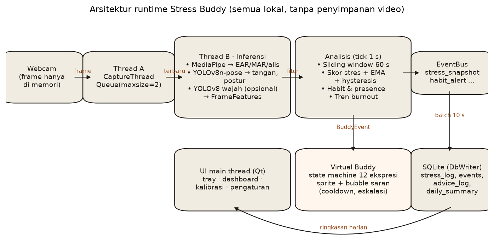

# Stress Buddy: Deteksi Dini Stres & Evaluasi Habit Pengguna PC

Aplikasi desktop yang memantau pengguna PC lewat webcam dan mendeteksi tanda lelah atau stres: mata tertutup lama (PERCLOS), kedipan, menguap, kerutan dahi, tangan ke dahi, postur, dan jarak ke layar. Umpan baliknya diberikan lewat kucing *Virtual Buddy* di bawah layar. Riwayatnya disimpan sebagai angka untuk evaluasi kebiasaan kerja harian. Semua pemrosesan berjalan lokal, dan frame video tidak pernah disimpan.

> Sistem ini adalah alat bantu kesadaran diri, **bukan alat diagnosis medis**.

Proyek dibangun mengikuti dokumen *Spesifikasi Build* per fase:
- Keputusan desain dan penyimpangan dari spesifikasi ada di [docs/DECISIONS.md](docs/DECISIONS.md).
- Audit terhadap prototipe lama ada di [docs/AUDIT_SPEC.md](docs/AUDIT_SPEC.md). Prototipe itu sendiri disimpan di `legacy/` sebagai referensi.



## Status fase

| Fase | Isi | Status |
|---|---|---|
| 1 | Setup environment, config, benchmark FPS | ✅ selesai |
| 2 | Dataset & anotasi (tool, pra-anotasi, split, augmentasi) | ✅ tool selesai · ⏳ anotasi manual & rekaman relawan |
| 3 | Training YOLOv8, evaluasi, demo detektor | ✅ pipeline selesai · ⏳ training menunggu label final & hardware |
| 4 | Analisis & skoring (EAR, PERCLOS, skor, hysteresis, burnout, habit, replay) | ✅ selesai |
| 5 | Virtual Buddy (12 ekspresi, sprite player, state machine, saran, debug panel) | ✅ selesai |
| 6 | Database, ringkasan harian, dashboard, ekspor CSV | ✅ selesai |
| 7 | Integrasi (thread kamera/inferensi, tray, kalibrasi, pengaturan, `src.main`) | ✅ selesai |
| 8 | Pengujian (benchmark, akurasi event, kondisi, kuesioner, uji kegagalan) | ✅ tool selesai · ⏳ data partisipan |
| 9 | Aset laporan, kerangka laporan, skenario demo | ✅ selesai · ⏳ video demo & isi Bab IV |

**Tanpa model hasil training**, aplikasi sudah jalan penuh: mata, menguap, dan kerutan diambil dari landmark MediaPipe (D-016). Begitu `models/best.pt` ada, detektor YOLO otomatis ikut dipakai.

## Instalasi

Butuh Python 3.11. Cara termudah di macOS adalah dengan [uv](https://docs.astral.sh/uv/):

```bash
brew install uv
uv python install 3.11
uv venv --python 3.11 .venv
uv pip install --python .venv/bin/python -r requirements.txt
```

Tanpa uv (Python 3.10/3.11 sudah terpasang):

```bash
python3.11 -m venv .venv
.venv/bin/pip install -r requirements.txt
```

Bobot model resmi (`yolov8n-pose.pt`, `face_landmarker.task`) diunduh otomatis saat pertama kali dipakai. Di macOS, izinkan akses kamera untuk Terminal/IDE di **System Settings → Privacy & Security → Camera**.

Kalau mau training di GPU NVIDIA, pasang PyTorch versi CUDA dulu (misalnya `pip install torch torchvision --index-url https://download.pytorch.org/whl/cu128`), lalu `pip install -r requirements.txt`.

## Menjalankan aplikasi

```bash
.venv/bin/python -m src.main
```

Alur pemakaian:
1. Saat pertama kali dijalankan, muncul **disclaimer** lalu **wizard kalibrasi** 20 detik (duduk tegak, lalu pejam sebentar).
2. Kucing duduk di bawah layar (di atas taskbar/dock). Ikon **tray** menunjukkan status kamera (titik merah = kamera aktif).
3. Interaksi dengan kucing:
   - **Klik kiri** → kucing bereaksi.
   - **Klik kanan** → menu: Jeda 30 menit, Diam hari ini, Dashboard, Pengaturan, Keluar.
   - **Seret** → memindahkan kucing di sepanjang tepi bawah layar.
4. Bubble saran punya tombol **Oke**, **Nanti** (tunda 10 menit), dan **Jangan hari ini**.
5. Saat ada aplikasi lain yang fullscreen, kucing bersembunyi dan saran ditahan.

| Opsi | Fungsi |
|---|---|
| `--source video.mp4` atau `--source folder/` | pakai video atau folder gambar, bukan webcam |
| `--source-fps 15` | kecepatan putar untuk file atau folder |
| `--record-features rek.jsonl` | rekam fitur angka (tanpa gambar) untuk replay dan uji event |
| `--seconds 60 --skip-intro` | uji otomatis tanpa dialog |

Pengaturan pengguna disimpan di `data/settings.yaml`. Hapus file itu untuk kembali ke `config.yaml`.

## Tool per fase

### Setup & benchmark (FASE 1, 8.3)

```bash
.venv/bin/python scripts/benchmark_fps.py                              # webcam + yolov8n, kotak orang + FPS (q = keluar)
.venv/bin/python scripts/benchmark_fps.py --pipeline --device cpu      # stack aplikasi: FPS, latensi, CPU%, RAM
.venv/bin/python -m pytest                                             # seluruh test
```

### Dataset (FASE 2)

Alur lengkap dan konvensi box ada di [docs/ANOTASI.md](docs/ANOTASI.md).

```bash
.venv/bin/python scripts/collect_data.py --relawan andi --kondisi terang     # rekam relawan (dengan persetujuan)
.venv/bin/python scripts/import_public.py nthu --src "~/Downloads/KAGGLE/3. NTHU DDD"
.venv/bin/python scripts/import_public.py uta --src "/path/ke/uta-rldd"
.venv/bin/python scripts/preannotate.py                                      # draf label dari landmark
# koreksi label di Roboflow/CVAT, export YOLO ke data/annotated/
.venv/bin/python training/split_dataset.py --src data/annotated              # split per orang + laporan
.venv/bin/python training/augment.py                                         # augmentasi train
.venv/bin/python training/check_dataset.py                                   # DoD: yolo val
```

### Training & evaluasi (FASE 3)

```bash
.venv/bin/python training/train.py                         # 100 epoch, imgsz 640, batch 16, patience 20 -> models/best.pt
.venv/bin/python training/train.py --model yolov8s.pt      # bila mAP50 < 0.80
.venv/bin/python training/evaluate.py --label-status final # metrik per kelas di split test -> docs/eval/
.venv/bin/python -m src.detection.face_detector --demo     # deteksi live (q = keluar)
```

### Analisis, Buddy, dashboard (FASE 4–6)

```bash
.venv/bin/python -m src.analysis.replay --file data/samples/sample.jsonl   # skor per detik dari fitur rekaman
.venv/bin/python -m src.buddy.demo                                         # kucing + debug panel (12 ekspresi, semua event)
.venv/bin/python -m src.ui.dashboard --demo-data                           # dashboard dengan 7 hari data dummy
.venv/bin/python scripts/generate_placeholder_sprites.py                   # sprite placeholder (tidak menimpa)
```

Ganti sprite dengan menimpa `src/buddy/assets/cat/<ekspresi>.png` (PNG RGBA 512×512, kaki di bawah-tengah). Tidak perlu mengubah kode. Bank saran ada di `src/buddy/assets/advice_id.yaml`.

### Pengujian (FASE 8)

```bash
.venv/bin/python scripts/scenario_session.py --peserta p01                 # sesi berskenario + label otomatis
.venv/bin/python scripts/eval_events.py --features docs/eval/sesi/p01_features.jsonl --labels docs/eval/sesi/p01_labels.csv
.venv/bin/python training/evaluate_robustness.py --method landmark --label-status final
.venv/bin/python training/evaluate_robustness.py --method yolo --label-status final
.venv/bin/python scripts/analyze_questionnaire.py template
.venv/bin/python scripts/analyze_questionnaire.py stress --ratings r.csv --db p01=data/p01.db
.venv/bin/python scripts/analyze_questionnaire.py ux --likert likert.csv --db p01=data/p01.db
```

Hasil ada di `docs/eval/`, dan checklist uji manual ada di [docs/eval/failure_tests.md](docs/eval/failure_tests.md).

### Laporan & demo (FASE 9)

```bash
.venv/bin/python scripts/make_report_assets.py   # grafik & tabel -> docs/report_assets/
```

- Kerangka laporan, keterbatasan, etika, dan skenario demo 5 menit ada di [docs/LAPORAN.md](docs/LAPORAN.md).
- Video demo direkam sendiri (screen record), tanpa menampilkan wajah orang tanpa izin.

## Struktur

```text
config.yaml            # satu-satunya tempat ambang, bobot, dan parameter
requirements.txt       # versi dipin
docs/                  # DECISIONS, AUDIT_SPEC, ANOTASI, LAPORAN, dataset_report, eval/, report_assets/
data/samples/          # skenario fitur sintetis untuk replay & test
data/raw/ annotated/ dataset/   # data gambar (tidak di-commit)
data/data.yaml         # konfigurasi dataset YOLO (4 kelas)
models/                # bobot model (tidak di-commit)
src/
  main.py              # entry point aplikasi
  core/                # config, device, events (dataclass + EventBus), pipeline
  capture/             # camera (CaptureThread)
  detection/           # classes, ear_calculator, pose_estimator, face_detector
  analysis/            # feature_extractor, sliding_window, stress_scorer, burnout_trend,
                       # habit_evaluator, calibration, engine, replay
  buddy/               # buddy_window, sprite_player, transforms, overlays, buddy_state,
                       # event_mapper, advice_engine, speech_bubble, controller, fullscreen, demo, assets/
  storage/             # db, repository, daily_summary, demo_data
  ui/                  # tray, dashboard, calibration_wizard, settings_dialog, theme
training/              # common, split_dataset, augment, check_dataset, train, evaluate, evaluate_robustness
scripts/               # benchmark_fps, collect_data, import_public, preannotate, generate_placeholder_sprites,
                       # scenario_session, eval_events, analyze_questionnaire, make_report_assets
tests/                 # pytest (Qt dijalankan offscreen)
legacy/                # prototipe lama (referensi, tidak dijalankan)
```

## Troubleshooting

| Masalah | Solusi |
|---|---|
| Kamera tidak terbuka / tray "Kamera tidak tersedia" | Izinkan kamera untuk Terminal/IDE (macOS), tutup aplikasi lain yang memakai kamera. Aplikasi mencoba lagi tiap 5 detik. Kamera eksternal: ubah `camera.index`. |
| `ensurepip` gagal dengan `pyexpat ... Symbol not found` | `python@3.11` dari Homebrew tidak cocok dengan macOS 26. Pakai Python dari `uv` (lihat Instalasi). |
| FPS rendah / CPU tinggi di laptop tanpa GPU | Aktifkan "Mode hemat" di Pengaturan (`inference.performance_mode`), atau turunkan `inference.imgsz` ke 320. |
| Kucing tidak bersembunyi saat fullscreen | Deteksi fullscreen butuh `pyobjc-framework-Quartz` (macOS) atau Windows. Di platform lain fitur ini nonaktif. |
| Buddy terlalu sering/jarang menegur | Atur `buddy.cooldown_*`, `buddy.max_per_hour`, dan `score.thresholds` di `config.yaml`, lalu ulangi kalibrasi. |
| Wizard kalibrasi gagal | Pastikan wajah terang dan menghadap kamera, dan mata benar-benar terpejam di fase kedua. Bisa dilewati (pakai nilai bawaan). |
| Ingin mulai dari nol | Pengaturan → Hapus semua data, atau hapus `data/stress_buddy.db` dan `data/settings.yaml`. |
